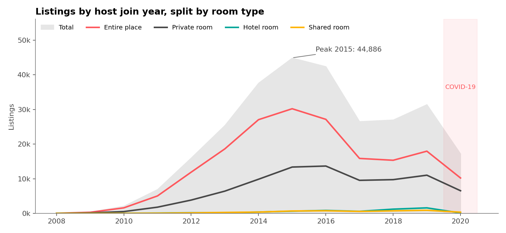
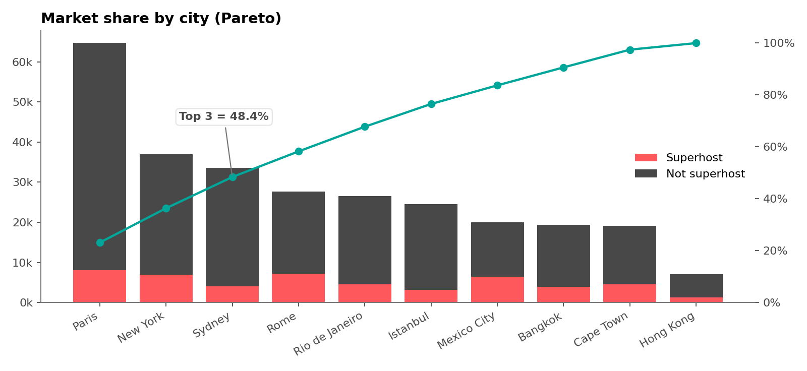
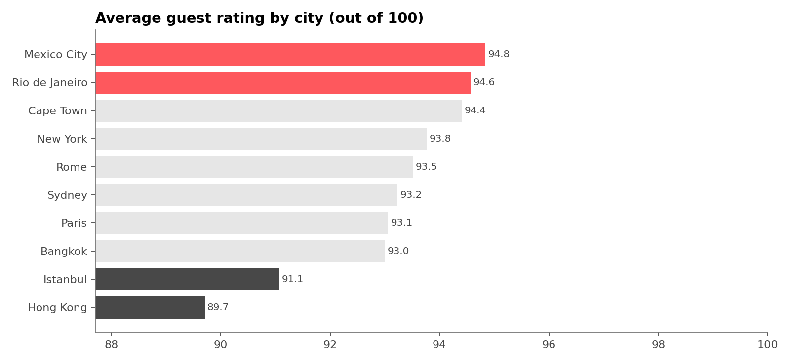
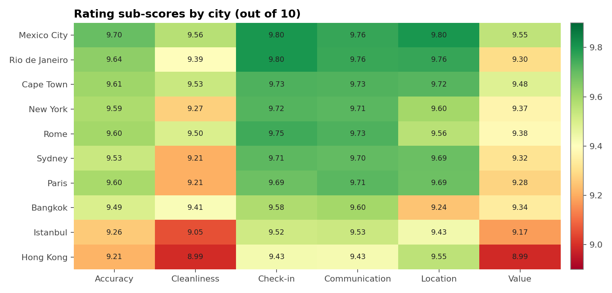
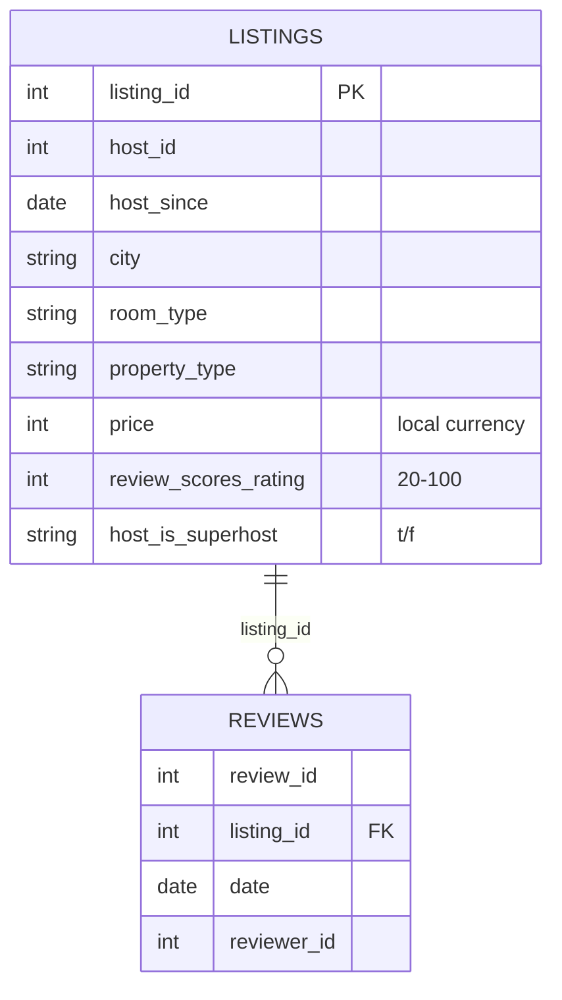

# 🏠 Global Airbnb Performance Dashboard — Power BI


This is an interactive Power BI report covering **279,712 Airbnb listings** and **5.37 million guest reviews** across **10 global cities**. It tells the story of Airbnb's growth, where the market is concentrated, and how guests rate each city.

The project is saved in **Power BI Project (PBIP)** format, so the report layout (PBIR JSON) and semantic model (TMDL) are plain text. They can be reviewed, diffed and version-controlled like code. The `.pbix` is available under [**Releases**](../../releases).

<!--
  📸 Add dashboard screenshots here (File → Export → PDF, or Windows Snipping Tool):
  
  
-->

---

## 📌 Business questions

1. How did Airbnb supply grow over time, and which room types drove it?
2. Which cities dominate the market, and how concentrated is it?
3. How do prices differ by room type?
4. Which cities do guests rate best and worst, and on which dimensions?

## 💡 Key insights

| | Insight |
|---|---|
| 📈 | **Growth peaked in 2015.** 44,886 of today's listings belong to hosts who joined that year. Joins slowed in 2016–17 as local regulation tightened, recovered in 2018–19, then dropped with **COVID-19** in 2020. |
| 🏙️ | **The market is concentrated.** **Paris, New York and Sydney hold 48.4% of listings.** Paris alone has 23%. |
| 💬 | **Demand ≠ supply.** By reviews, the top 3 are Paris, **Rome** and New York (59% of reviews). Rome has fewer listings than Sydney but **2.3× the reviews**. |
| 🛏️ | **Entire places dominate** with 65% of listings. Hotel and shared rooms together are under 4%. |
| 💶 | **In Paris, a hotel room costs about 1.9× an entire Airbnb apartment** (median €158 vs €82). |
| ⭐ | **Mexico City (94.8) and Rio (94.6) are the best-rated cities. Hong Kong (89.7) and Istanbul (91.1) are the worst.** Across all cities, **cleanliness** and **value for money** are the weakest sub-scores. |

<p align="center">
  
  
  
  
</p>
<p align="center"><sub>Figures regenerated from the raw data with <code>analysis/make_charts.py</code>.</sub></p>

Every number here is verified against the raw data. See [docs/insights-and-caveats.md](docs/insights-and-caveats.md) for the full check, including two important caveats about prices and the growth chart.

---

## 📊 Report pages

### 1 · Overview

- **KPI cards:** Listings (279,712) · Cities (10) · Hosts (182,024) · Property types (144) · Reviews (5,372,983)
- **Growth line chart:** listings by host join year, split by room type, with shaded lifecycle phases (*Introduction → Growth → Maturity → Decline → Reinvention → COVID-19*)
- **Narrative caption** explaining the curve

### 2 · Ratings

- **Pareto combo chart:** listings per city, stacked by superhost status, with a cumulative-% line
- **Avg price by room type** bar chart
- **Sub-score matrix:** Accuracy, Cleanliness, Location and Value by city
- **Avg rating by city** column chart with a gradient colour scale
- **Insight call-outs** next to each visual

## 🧱 Data model



- **2 fact-style tables** loaded from CSV via Power Query, with types set in M.
- **1 relationship:** `Reviews[listing_id]` many-to-one `Listings[listing_id]`.
- **22 DAX measures,** including a dynamic **Pareto** (`RANKX` + cumulative `CALCULATE`/`FILTER`) and a slicer-aware **Top-3 share** (`TOPN` + `ALLSELECTED`).
- The source path is a **`DataFolder` parameter**, so anyone can refresh the model by pointing it at their own copy of the data.

Full documentation:

- [DAX measures](docs/dax-measures.md): definitions, formats, and where each one is used
- [Data dictionary](docs/data-dictionary.md): every column, with types and data-quality notes

<details>
<summary><b>DAX example: Pareto cumulative %</b></summary>

```dax
City Rank =
RANKX ( ALL ( Listings[city] ), [Total Listings], , DESC )

Cumulative Listings =
VAR CurrentRank = MAXX ( VALUES ( Listings[city] ), [City Rank] )
RETURN
    CALCULATE (
        [Total Listings],
        FILTER ( ALL ( Listings[city] ), [City Rank] <= CurrentRank )
    )

Cumulative % =
DIVIDE ( [Cumulative Listings], CALCULATE ( [Total Listings], ALL ( Listings[city] ) ) )
```
</details>

---

## 🗂️ Repository structure

```
airbnb-powerbi-dashboard/
├── Airbnb_Dashboard.pbip                  ← open this in Power BI Desktop
├── Airbnb_Dashboard.Report/               ← report layout (PBIR, one JSON per page/visual)
│   ├── definition/
│   │   ├── pages/                         ← Overview + Ratings
│   │   ├── bookmarks/
│   │   └── report.json
│   └── StaticResources/                   ← theme + Airbnb logo
├── Airbnb_Dashboard.SemanticModel/        ← data model (TMDL)
│   └── definition/
│       ├── tables/                        ← Listings.tmdl, Reviews.tmdl (+ auto date tables)
│       ├── relationships.tmdl
│       └── expressions.tmdl               ← DataFolder parameter
├── analysis/
│   ├── validate_insights.py               ← recomputes every KPI and claim from the CSVs
│   ├── make_charts.py                     ← regenerates docs/images
│   └── requirements.txt
├── data/
│   ├── README.md                          ← where to download the data
│   └── sample/                            ← 1,000-listing stratified sample (runs out of the box)
└── docs/
    ├── dax-measures.md
    ├── data-dictionary.md
    ├── insights-and-caveats.md
    └── images/
```

## 🚀 Getting started

**Option A: just look at it.** Download `Airbnb_Dashboard.pbix` from [Releases](../../releases) and open it in Power BI Desktop. The data is already embedded.

**Option B: work from source (PBIP).**

1. Install [Power BI Desktop](https://powerbi.microsoft.com/desktop/) (Windows).
2. Clone the repo:
   ```bash
   git clone https://github.com/<your-username>/airbnb-powerbi-dashboard.git
   ```
3. Download the dataset into `data/raw/` (see [data/README.md](data/README.md)).
4. Open **`Airbnb_Dashboard.pbip`**, go to **Transform data → Edit parameters**, and set `DataFolder` to your `data\raw\` path. Keep the trailing backslash.
5. Click **Refresh**.

> 💡 For a quick, lightweight refresh while editing visuals, point `DataFolder` at `data\sample\` instead.

**Validate the numbers with Python** (no Power BI needed):

```bash
pip install -r analysis/requirements.txt
python analysis/validate_insights.py              # uses data/raw if present, else data/sample
python analysis/make_charts.py --data data/raw    # rebuilds the README figures
```

## ⚠️ Caveats

- **Prices are in local currency** (EUR, USD, THB, ZAR, …). The global "Avg price by room type" chart mixes currencies, so compare prices within a city.
- **"New listings" counts hosts by join year** (`host_since`) in a 2021 snapshot of active listings. Older years are undercounted, and 2021 is a partial year.

Details and the improvement roadmap are in [docs/insights-and-caveats.md](docs/insights-and-caveats.md).

## 🛠️ Tools

Power BI Desktop · Power Query (M) · DAX · PBIP / PBIR / TMDL · Python (pandas, matplotlib)

## 🙏 Acknowledgements

- Dataset: [Airbnb Listings & Reviews](https://mavenanalytics.io/data-playground/airbnb-listings-reviews), Maven Analytics Data Playground, originally sourced from [Inside Airbnb](http://insideairbnb.com/).
- Airbnb name and logo are trademarks of Airbnb, Inc. This is an independent portfolio project, not affiliated with Airbnb.

## 📄 License

Code and report definition: [MIT](LICENSE). The dataset is subject to its own terms; see [data/README.md](data/README.md).
